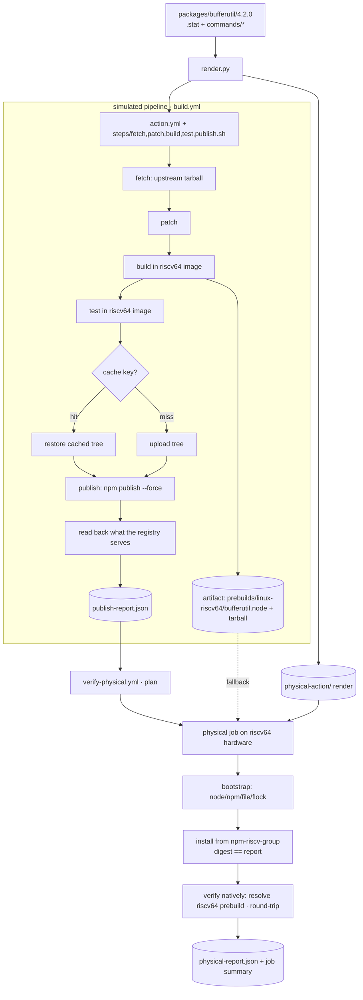

# 物理环境验证计划（P1：硬件执行层）

> 版本：**v2**（2026-11-25 二次讨论后修订；v1 为同日首轮 8 条答复的落稿）
> 状态：**方案待确认，仍未开工**
> 日期：2026-11-25
> 定位：在现有模拟流水线之上**附加**一层"真实 RISC-V 硬件上的安装 + 执行"验证；
> 不改动构建、不参与缓存、不阻塞发布。摘要记录见 `.dsh/plan.md` D41。

---

## 0. 一句话结论

每个发布的产物，除了在 riscv64 容器（qemu/模拟）里跑通之外，还要在一台**真实 riscv64 硬件**
的常驻 runner 上，从**组仓库**（`npm-riscv-group`）像消费者那样装下来、跑起来，并把
"硬件事实 + 字节摘要 + 执行结论"写成 `physical-report.json` 与 job summary。

物理层用**独立工作流 + 独立的 action 模板**实现，模板内**不使用 docker**（不依赖 DinD）。

---

## 1. 已确认的决策（来自 2026-11-25 讨论）

| # | 问题 | 决策 | 落点 |
| --- | --- | --- | --- |
| 1 | registry 可达性 | 从**组仓库** `https://forgestash.artifact.yuantu.ac.cn/repository/npm-riscv-group` 取包；发布仓库与获取仓库**是两个地址**，新增配置项；从 build 的 artifact 安装作为**兜底** | §3、§9 |
| 2 | 物理机 node | 可能未安装；容器常驻，故**首次安装一次即可**（幂等 bootstrap） | §7 |
| 3 | 触发模型 | **独立 workflow** + `workflow_run` / `workflow_dispatch` | §8 |
| 4 | 验证范围 | 每次只验**本次变化/发布的包**（由 build 的发布报告驱动） | §8 |
| 5 | 重档（上游套件） | 暂不采用；后续**只改 `verify` 片段**即可扩充 | §5 |
| 6 | 报告落点 | job summary + `physical-report.json` artifact；**不回写仓库** | §6 |
| 7 | `flock` / `file` | 可能缺失；同 2，首次安装一次 | §7 |
| 8 | README | `How it works` 增加**单配方视角的完整流程图** | §10 |

不变量：build key / publish key / 发布语义 / L0–L2 门禁 / 现有三个配方一律不动。

### 1.1 二次讨论定稿（v2 增补）

| # | 问题 | 定稿 | 落点 |
| --- | --- | --- | --- |
| a | node 门槛 | **硬门槛 node ≥ 20**（不是"18 合格"）；bootstrap 拿不到就报 `environment` 并给一次性手工命令，**绝不**静默降级用 18 去验 | §7 |
| b | 容器内无 sudo | 接受"**一次性手工装好、之后每次只检查**"的流程；`environment` 报告里给出可复制的命令 | §7 |
| c | 组仓库鉴权 | 当前 `npm-riscv-group` 是**开放仓库（匿名可读）**，无需认证；但**配置项保留**，且读仓库与发布仓库**允许各自不同的认证信息**（`physical.auth` 独立于 `npm_publish.auth`，含 `none`） | §3 |
| d | 兜底 tgz 体积 | **只有报告里 `served` 状态为 `unverified` 的目标才上传** tgz（build 侧按发布报告决定），`plan` 侧只据此标记"可走 tarball 兜底" | §9 |
| e | 矩阵形态 | 保留静态矩阵 + `if:` 过滤；**按执行结果再调整**（不预做优化） | §8 |
| f | `file` 缺失 | 允许退化为读 ELF 头 `e_machine == 243`，但必须在报告与 summary 里**提示更新环境**（与 b 同一条手工流程一并解决） | §7、§6 |

---

## 2. 总体形状

```
build.yml（模拟环境，现状不变）
  每个目标： fetch → patch → build（riscv64 镜像）→ test（riscv64 镜像）→ publish
                                                                        ├─ 读回断言（--assert-served）
                                                                        ├─ publish-report-<slug>.json  ← 新增
                                                                        └─ physical tarball          ← 新增（仅 served=unverified）
  渲染物理 action（render.py --template physical）→ physical-action/  ← 新增（几 kB）

verify-physical.yml（新，跑在 [self-hosted, linux, riscv64]）
  plan（ubuntu-latest，便宜）：下载 publish-report-*.json → 合并 → 输出本次要验的包清单
  physical（矩阵 × 3 配方，按清单过滤）：bootstrap → 下载 physical-action → install → verify → 报告
```

设计理由：
- **硬件稀缺** → 物理作业绝不能挂在发布路径上；`workflow_run` 让它异步排队。
- **物理机尽量"零依赖"** → 材料（渲染好的 action、发布报告、兜底 tarball）都由 build 侧上传，
  物理机不 checkout 仓库、不装 python、不跑 docker：只需要 bash + node/npm + 几个工具。
- **诚实性** → 报告要能把"字节是主流程发出去的那份"钉住（§6）。

---

## 3. 新配置项：发布仓库 ≠ 获取仓库

`.stat` 新增**顶层** `physical` 段（与 `npm_publish` 平级，因为它是"验证"而不是"发布"的配置）：

```yaml
physical:
  # 读路径：消费者会指向的组仓库（聚合了 private 仓库；地址末尾是否带 "/" 由
  # normalize_registry 统一补成 "/"，与 npm 的 nerf-dart 规则一致）
  registry: https://forgestash.artifact.yuantu.ac.cn/repository/npm-riscv-group
  token_env: NODE_AUTH_TOKEN     # 只在该仓库需要凭证时才用；开放仓库可留空
  auth: none                     # none | token | basic —— 读仓库自己的认证，不必与发布一致
  source: registry               # registry | tarball —— 默认读组仓库，tarball 为兜底
```

规则（写进 `docs/recipe-spec.md` 与 `recipe_lib.validate_stat`）：
- 配方若提供 `commands/install` 或 `commands/verify` → `physical.registry` **必需**，否则渲染报错。
- `auth ∈ {none, token, basic}`（`none` = 匿名只读，当前组仓库即此形态）、`source ∈ {registry, tarball}`；未知值报错（不做静默兜底）。
- **读仓库与发布仓库的认证相互独立**（用户要求）：`physical.auth` / `physical.token_env` 与
  `npm_publish[].auth` / `token_env` 分开解析；一个配方可以是"发布用 basic + 读取用 none"，
  `.npmrc` 由 `setup_auth` 只为需要凭证的那一侧生成（`none` 时不写任何 auth 行，
  也不做"顺手带上发布凭证"的隐式行为）。
- 渲染期可覆盖：`render.py --physical-registry`；工作流变量 `PHYSICAL_REGISTRY` 作为仓库级默认，
  与 `PUBLISH_REGISTRY` 同样的优先级（命令行 > 变量 > `.stat`）。
- **不引入** `physical.enabled`：片段存在即参与，片段缺失即退出物理验证（§5 的 opt-out 规则）。

---

## 4. 新 action 模板：`.github/templates/physical.template.yml`

**硬约束**：模板内不出现 `docker`/`docker run`/`--platform`。所有步骤直接跑在 runner 上。

渲染产物（每个配方一份）：`physical/<slug>/{action.yml, steps/install.sh, steps/verify.sh}`。

| 输入 | 含义 |
| --- | --- |
| `pkg` / `ver` | 要验证的包与版本（由工作流从发布报告传入，避免与配方目录漂移） |
| `registry` | 读仓库地址（默认取 `.stat` 的 `physical.registry`） |
| `expected_integrity` | 主流程发布时读回/上传得到的 sha512（来自 report） |
| `source` | `registry`（默认）或 `tarball`（兜底，读 build 上传的 tgz） |
| `token_env` | 凭证环境变量名 |

两个步骤（片段由配方提供，模板只负责编排与日志）：

| step | 契约 | 失败分类 |
| --- | --- | --- |
| `install` | 在 `$RUNNER_TEMP/verify.XXXXXX` 内建立隔离环境（`HOME`、`npm_config_cache` 都在其中）；写隔离 `.npmrc`（复用 publish 侧的 `setup_auth`，按 nerf-dart 最长前缀）；`npm pack <pkg>@<ver>` 或 `npm i <pkg>@<ver>`；校验取回 tarball 的 integrity == `expected_integrity`；在消费者工程里安装（绝不 `-g`） | `registry`（不可达/鉴权）、`digest`（字节与主流程不符）、`install`（安装失败） |
| `verify` | 断言解析出的 `.node` 来自 riscv64 分支（`prebuilds/linux-riscv64/` 或 `@rolldown/binding-linux-riscv64-gnu`）、`file` 判为 RISC-V ELF、采集硬件事实（`uname -m`、`/proc/cpuinfo` 型号与 `isa`、glibc、node/npm）；跑配方自带的消费者冒烟 | `execute`（真机上执行失败）、`environment` |

**模板输出的报告结构**（`$RUNNER_TEMP/verify.*/physical-report.<slug>.json`）在 §6 固定，
由模板统一写、`verify` 片段只追加断言结果，避免每个配方各写一套。

---

## 5. 配方侧的 `install` / `verify` 片段

| 配方 | 安装断言 | 执行断言（消费者视角，M1/M2 范围） |
| --- | --- | --- |
| `bufferutil@4.2.0` | 主包 174 kB；`prebuilds/linux-riscv64/bufferutil.node` 存在 | `require()` 后解析路径必须是 riscv64 prebuild；`mask/unmask` 往返一致（与现有 test 片段同一断言，但在**装好的包**上跑） |
| `utf-8-validate@6.0.6` | 主包 252 kB；同上 prebuild 目录 | `isUtf8` 正负例、解析路径断言 |
| `rolldown@1.3.3` | wrapper 232 kB + binding 9.1 MB 由 `optionalDependencies` 自动带入（**这正是要验的点**：消费者不需要手动装平台包） | `rolldown({input})` 打一个 bundle，断言加载的 binding 文件落在 `@rolldown/binding-linux-riscv64-gnu/`、ELF 为 riscv64 |

- opt-out 规则：某配方无 `install`/`verify` 片段 → `--check-all` 必须**报出"该配方不参与物理验证"**
  （显式可见，而不是静默跳过）。
- **重档按下不表**（决策 5）：上游套件（bufferutil 8 例、utf-8-validate 10 例、rolldown
  `emit-debug-data` 3 文件）留到后续——届时只改 `verify` 片段（取自上游源码树或 `source: tree`
  恢复 995 MB 缓存树），模板、工作流、报告结构都不变。

---

## 6. 报告与信任链

三层摘要对齐，任何一环不符即 `digest` 失败：

1. 主流程：`npm publish` 上传的包体摘要（`npm pack --json` → 与上传一致）→ `publish-report-<slug>.json`；
2. 读回：`--assert-served` 的结论（`dist.integrity` / `dist.shasum` / 下载自算，三种形态，见 D39）；
3. 物理机：`npm pack` 取回的 tarball 摘要 == `expected_integrity` == 读回结论。

`physical-report.<slug>.json` 字段（模板统一写）：

```json
{
  "pkg": "bufferutil", "ver": "4.2.0",
  "source": "registry|tarball", "registry": "…/npm-riscv-group/",
  "expected_integrity": "sha512-…", "installed_integrity": "sha512-…",
  "binding": "node_modules/bufferutil/prebuilds/linux-riscv64/bufferutil.node",
  "served": "dist.integrity|shasum|tarball|unverified",   # 来自 build 的发布报告
  "elf": "RISC-V", "elf_check": "file|elf-header(degraded)",
  "node": "v22.22.1", "npm": "10.9.4", "glibc": "2.39",
  "host": {"uname_m": "riscv64", "model": "…", "isa": "rv64imafdc…"},
  "checks": [{"name": "round-trip", "ok": true, "detail": "…"}],
  "verdict": "ok|install-failed|digest-mismatch|execute-failed|environment",
  "duration_s": 12.3
}
```

- job summary：每包一行结论 + 硬件事实；失败项把 detail 打出来。
- 失败分类必须在报告里显式出现——`environment`（node 太旧、磁盘不足、不是 riscv64、残留目录，
  含"`file` 缺失、环境该更新"）**不得**被读成"产物坏了"（教训同 D39：证据不足 ≠ 证据相反）。
- `elf_check: elf-header(degraded)` 是**通过但降级**的判定：verdict 可为 `ok`，
  同时 summary 顶部挂一条 "environment needs updating: install file" 提示，
  并把它计入 §7 的"待手工补装"清单（与无 sudo 的情况走同一条人工路径）。

---

## 7. 常驻容器的整洁性与 bootstrap

**bootstrap（幂等，首次才真正安装）**：物理 workflow 的第一个 job（`ubuntu-latest` 上无法预检，
故放在物理 runner 上、作为矩阵前的准备 job），逐项检查、缺什么装什么、打印清单：

| 工具 | 用途 | 缺失时 |
| --- | --- | --- |
| `node` **≥ 20**（硬门槛） | 执行安装与断言 | 仅首次：从发行版仓库安装（riscv64 无官方 node 二进制）；装到的版本 < 20 → `environment` 失败并给出一次性手工命令，**不用 18 勉强跑** |
| `npm` ≥ 9 | `npm pack --json` 等 | 同上 |
| `file` | ELF 架构判定 | 缺失则退化到 node 读 ELF 头（`e_machine == 243`），判定仍有效但标记 `elf_check: elf-header(degraded)` 并在 summary 提示"环境该更新" |
| `flock`（util-linux） | 容器内二次互斥 | 缺失则退化为"只靠 workflow `concurrency`"，并在日志声明 |
| `gh` | 下载 build 的 artifact | 仅首次安装；或用 `curl` + REST 兜底 |

- 幂等：全部 `command -v` 先查，缺才装；装完写一行 `bootstrap: installed node@x, file, flock` 到 summary。
- 需要容器内 sudo：若 runner 用户无 sudo，bootstrap 报 `environment` 并给出手工一次性命令
  （**不静默失败**）；用户已确认接受"一次性手工装好、之后每次只检查"的流程，因此这些命令必须
  可直接复制粘贴，并写进 job summary 与 `physical-report.json` 的 `environment` 块。
- 版本门槛是硬性的：`node < 20` 时**不尝试**任何"降级也能跑"的路径——物理验证的意义就是
  在今天的运行时上跑通，用旧 node 验出来的绿灯不是用户会遇到的绿灯。
- 常驻容器 → 这些安装**只发生一次**，之后每次运行只做检查（秒级）。

**每次运行的整洁性**：
- `tmp=$(mktemp -d "$RUNNER_TEMP/verify.XXXXXX")` + `trap cleanup EXIT`（失败也要清）。
- `HOME`、`npm_config_cache`、`.npmrc` 全部指向该 tmp；绝不写 runner 的全局 node_modules、绝不 `-g`。
- preflight：`uname -m` 必须是 `riscv64`（防标签配错，`environment` 类失败）；可用空间下限（如 <5 GB 拒绝运行）；
  清理上次崩溃残留（`verify.*` 超过 6 小时）并上报"清掉了几项"。
- postflight：断言 tmp 已删除；磁盘占用回落到阈值内才 `ok`。
- 互斥：workflow 级 `concurrency: physical-riscv`（`cancel-in-progress: false`）+ 容器内 `flock`。
- 超时：作业 `timeout-minutes: 30`，卡住的 `npm i` 不能长期占用稀缺 runner。

---

## 8. 工作流改造

### 8.1 `build.yml` 新增（只增不改）

1. `publish-report-<slug>.json`：发布步骤在 `--assert-served` 之后写出（helper 新增 `--report <path>`），
   由 build matrix 作业 `upload-artifact`（保留 30 天）。
2. `physical tarball`（兜底用，**有条件的**）：发布前 `npm pack` 的 tgz，**只在该目标的发布报告
   `served: unverified` 时上传**（bufferutil/utf-8-validate 各 ~200 kB，rolldown 9.1 MB），保留 7 天。
   常规发布不产生这个附件。
3. `physical-action/`：`render.py --template .github/templates/physical.template.yml --out-dir`，
   一个 job 渲染三个配方，打包上传（几 kB）。物理机因此不需要 python/仓库。

### 8.2 `verify-physical.yml`（新）

```yaml
name: verify on riscv64 hardware
on:
  workflow_run:
    workflows: ["build riscv64 packages"]
    types: [completed]
    branches: [main]
  workflow_dispatch:
    inputs: {run-id: ..., pkg: ..., ver: ...}
permissions: {contents: read, actions: read}
concurrency: {group: physical-riscv, cancel-in-progress: false}

jobs:
  bootstrap:            # 幂等环境准备，见 §7
    runs-on: [self-hosted, linux, riscv64]
  plan:                 # 下载并合并 publish-report-*.json，输出待验清单
    needs: bootstrap
    runs-on: ubuntu-latest
  physical:             # 静态矩阵 × 3，按 plan 的输出用 if: 过滤
    needs: plan
    runs-on: [self-hosted, linux, riscv64]
    timeout-minutes: 30
    strategy: {matrix: {include: [bufferutil, utf-8-validate, rolldown]}, fail-fast: false}
```

- 采用**静态矩阵 + `if:` 过滤**（决策 4）：不使用动态 `uses:`（`uses` 不接受表达式），
  而是下载渲染好的 action 后 `bash .physical/<slug>/steps/install.sh` / `verify.sh`（与 composite
  action 内联执行等价）；`action.yml` 仍然渲染，供人工复用与文档引用。
- 触发过滤：`workflow_run` 只在 `conclusion == success` 时进入；PR 构建不会发布，故不触发物理验证。
- 无发布（`SKIP_PUBLISH=true` 或全部命中缓存且未重发布）→ `plan` 输出空清单 → 物理作业全部 skip，
  并在 summary 写明"本次没有需要硬件验证的包"。
- `workflow_dispatch` 支持对**旧版本/某次 run-id**补验（硬件空闲时来回补历史，不占发布路径）。

---

## 9. 兜底：组仓库不可达 / 鉴权失败

1. `install` 先按 `source: registry` 走：`npm pack --registry $PHYSICAL_REGISTRY`；
2. 失败（网络/401/404）→ 若该目标的发布报告 `served` **不是** `ok`（即
   `dist.integrity` / `dist.shasum` / 下载自算都拿不到、状态为 `unverified`）→ 取 build 上传的 tgz，
   **校验其摘要仍等于 `expected_integrity`**（兜底不等于放水：字节必须还是主流程发出去的那份）；
   若 `served` 已确证（有摘要）而物理机仍读不到 → **不做 tarball 兜底**，按 `registry` 类失败报出
   "物理机与组仓库不通"，因为这已经不是仓库能力问题而是这台机器的网络问题；
3. 两种方式都失败 → `verdict: registry`，summary 写明"物理机与组仓库不通"，
   **不判产物有问题**（这正是 D39 的教训）。

兜底路径也记录在报告 `source` 字段里，便于事后区分"这次验的是组仓库还是 build 的 tgz"。

上传策略（用户二次讨论定稿）：build 侧**只对 `served: unverified` 的目标**上传 tgz，
因此常态下（组仓库能报出摘要或能自行下载校验）不产生 9 MB 的 rolldown tgz 附件；
`plan` job 读取报告后，把"可兜底"标记为 `fallback: true` 的目标才允许 `install` 走第 2 步。

---

## 10. README：`How it works` 增加单配方流程图（决策 8）

在现有 `How it works` 章节追加一段"从 `bufferutil@4.2.0` 看一遍完整流程"，mermaid 草图：



配套文字说明（每一段落到具体步骤名/文件），并明确"两层各证明什么、不证明什么"。

形式约定（据 dc17af8 的取舍）：README 的 runner 小节已被用户刻意精简，**流程图只加在
`How it works`**，runner 小节不再扩写。图形表达优先 mermaid（跨模拟/物理两层画在一张图里
最直观）；若希望文件脱离 GitHub 渲染也自解释，则沿用该章节现有 ASCII 图表的风格扩成两栏。

**已实现（2026-11-26）**：`README.md` 的 `How it works` 末尾新增 "One recipe through both
layers"，用 **ASCII 单列流程**（11 个编号步骤 + 右列标注对应文件/步骤名）+ 一张
"proves / does not prove" 的两行表，落地本节要求的"每段落到具体步骤名/文件"与
"两层各证明什么、不证明什么"。

**为何没用 mermaid（本节的第二选择）**：本机没有任何可解析或渲染 mermaid 的手段
（`mmdc`、`mermaid` 的 CLI、`@mermaid-js/parser` 的 flowchart 语法、DOM shim、浏览器
一律没有；`mermaid 11.17.2` 的 `parse()` 在 Node 里直接报 `DOMPurify.addHook is not a
function`，其流程图 jison 解析器手接 `yy` 也报 `reading 'firstGraph'`），也就是说交付一块
**无法本地验证能否被 GitHub 渲染**的 diagram，风险是渲染出错误框。本节本来就允许 ASCII
变体（"沿现有风格扩成两栏"），且 ASCII 在任何环境下自解释，故取 ASCII；若后续要换 mermaid，
块本身替换即可，文字说明不用动。

**成品不具体到某个配方**（据用户 2026-11-27 反馈）：README 里讲的是"任意一个配方"走过的
完整路径（`packages/<pkg>/<version>` + 占位符），并把配方之间的差异交给收尾那段说清（哪些
片段有/没有、`artifacts.path` 指什么、`commands/verify` 断言什么），而不是拿 bufferutil 举
一个被删减的例子。草图里有三处与仓库不符，改成通用表述时一并纠正：patch 步**只在配方有
`patches/` 时存在**（`upstream_increments` 类补丁不参与构建）；`fetch` 是 **git clone at
pinned ref**（`source`/`npm` 是兜底路由），不是"上游 tarball"；构建产物是 **`.stat
artifacts.path` 指的东西**，tarball 仅在 `served: unverified` 时才留。


---

## 11. 自身校验（不依赖硬件也能绿）

1. **渲染**：`render.py --check-all --template physical` 覆盖三配方；缺片段要报（§5 的 opt-out 规则）；
   `--template physical` 的必需集合是 `install` + `verify`，主模板仍是 `build` + `test`。
2. **快照**：`tests/golden/<slug>/physical.yml` + `steps/{install,verify}.sh`；`regen_golden.py` 覆盖两套模板。
3. **工作流断言**：`runs-on` 标签集合、`concurrency` 组、`timeout-minutes`、`workflow_run` 过滤、
   `permissions` 只读；"没有 docker"用断言钉住（模板渲染结果里不得出现 `docker`）。
4. **本地排练**（无硬件）：在 riscv64 镜像里直接跑渲染出的 `install.sh`/`verify.sh`（父进程只 `docker run` 一次，
   等同 L1）；`source: tarball` 路径用 build 上传的 tgz 排练；`source: registry` 用 verdaccio 排练。
5. **不新增门禁**：物理层的失败不进入 L0/L1/L2，也不影响 build key / publish key。

---

## 12. 里程碑

| 阶段 | 内容 | 目的 |
| --- | --- | --- |
| **M1** | bufferutil 一个配方：`physical.template.yml` + 两片段 + `workflow_dispatch` 手动跑 + 报告 + bootstrap | 一次性打掉所有未知：**能否拿到 node ≥ 20**（拿不到就报 environment + 手工命令）、`file`/`flock` 是否在（缺则记录降级）、组仓库匿名可达性、容器 sudo 情况、残留清理 |
| **M2** | `workflow_run` 自动触发 + `plan` 过滤（只验本次发布的包）+ utf-8-validate/rolldown 的 install/verify + build 上传 report/action/tarball | 让物理验证成为发布后的默认动作 |
| **M3** | README 流程图与"证明/不证明"章节、失败分类与 summary 定稿、文档与 change-log 收口 | 对用户可见的信任背书 |

---

## 13. 风险与剩余待办

### 13.1 已定（2026-11-25 二次讨论）

| 原未决项 | 定稿 |
| --- | --- |
| node 版本门槛 | **≥ 20 硬门槛**；bootstrap 装不到 20 → `environment` 失败 + 一次性手工命令，不用 18 顶 |
| 容器内 sudo | 接受"一次性手工装 + 之后只检查"；命令必须可直接复制，写进 summary 与报告 |
| 组仓库鉴权 | 当前开放匿名可读；配置项保留，`physical.auth ∈ {none, token, basic}`，**与发布认证互相独立** |
| 兜底 tgz 体积 | 只对 `served: unverified` 的目标上传；`plan` 只标记可兜底目标 |
| 矩阵形态 | 保留静态矩阵 + `if:` 过滤，按执行结果再调 |
| `file` 缺失 | 允许退化为 ELF 头 `e_machine == 243`，但标记 `elf_check: degraded` + 提示更新环境 |

### 13.2 仍需 M1 实测才能落定的

1. **能否拿到 node ≥ 20**：这台机器的发行版仓库到底给到哪个版本（18 / 20 / 22）。若给不到 20，
   是走"换发行版源 / 装官方非 riscv64 口径的替代构建 / 手工编译"哪条路——这属于 §7 的一次性人工项，
   M1 先报事实再决定具体办法。
2. **容器内 sudo 实况**：有则 bootstrap 自动完成；无则记录人工步骤，并确认"之后每次只检查"确实够用。
3. **`file`/`flock` 是否在**：决定 `elf_check` 常态是 `file` 还是 `degraded`，以及"环境该更新"这条提示何时能消掉。
4. **组仓库匿名读取的实际行为**：拿到的是完整 manifest 还是只有 `dist.tarball`（决定 §9 兜底触发频率）。
5. **物理机到组仓库的网络路径**：若物理机根本读不到，`served: unverified` 之外的包也会常态走兜底——
   届时可能要放宽"仅 unverified 才上传"的规则（这条规则只解决体积，不解决可达性）。

## 14. 改动清单（文件级，供开工时对照）

新增：
- `.github/templates/physical.template.yml`
- `.github/workflows/verify-physical.yml`
- `packages/{bufferutil/4.2.0,utf-8-validate/6.0.6,rolldown/1.3.3}/commands/{install,verify}`
- `tests/golden/<slug>/physical.yml`、`tests/golden/<slug>/steps/{install,verify}.sh`
- `tests/test_physical.py`（渲染/片段/无 docker/报告结构）

修改：
- `scripts/recipe_lib.py`：`SNIPPET_NAMES` += `install`/`verify`；模板级必需集合；`physical` 段校验
- `scripts/render.py`：`--template` 支持物理模板、`--physical-registry`、`setup_auth` 抽取为独立片段
- `scripts/publish_manifest.mjs`：`--report <path>` 输出发布报告
- `.github/workflows/build.yml`：上传 report / physical-action（+ 仅当 `served: unverified` 时的 physical tarball）
- `packages/*/.stat`：新增 `physical` 段
- `docs/recipe-spec.md`（物理模板与片段契约、`physical` 配置、§10 校验表）、`README.md`（§10 流程图 + 触发方式）、
  `.dsh/plan.md`（D41 摘要）、`.dsh/change-logs/`
- `tests/regen_golden.py`、`tests/test_render.py`、`tests/run_action_locally.py`（能跑物理模板的本地排练）
